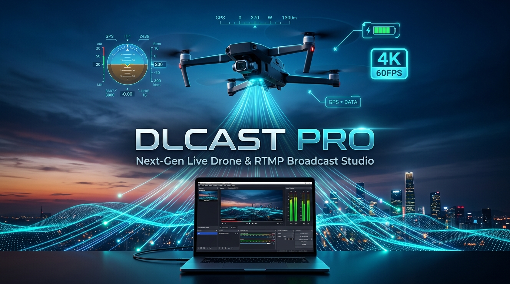
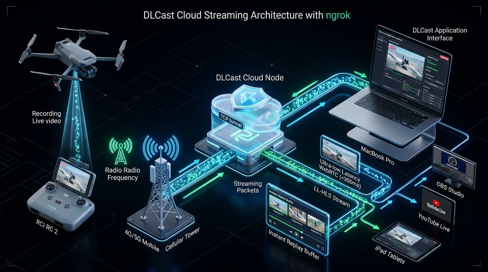
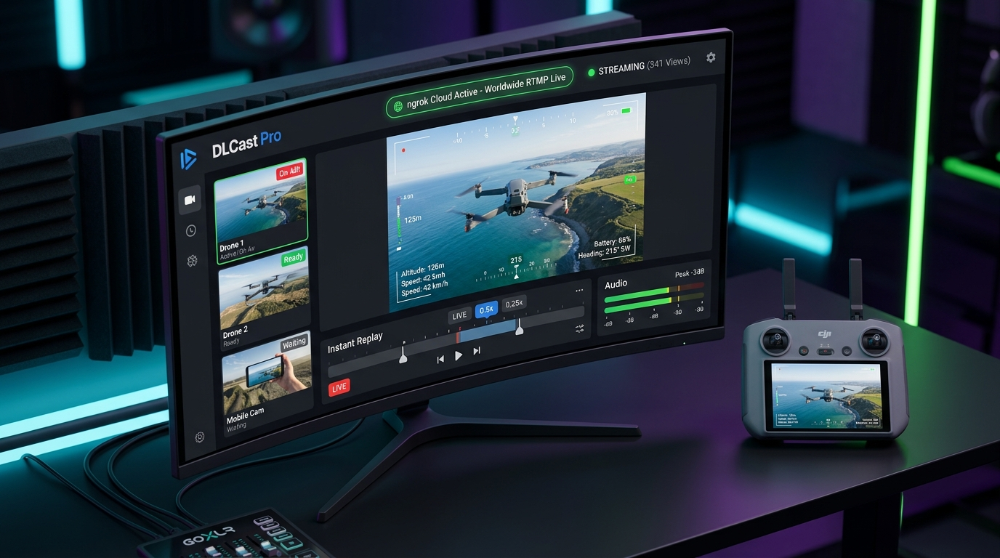

<div align="center">



# DLCast Pro 2.0
### Estúdio de Transmissão ao Vivo de Alta Performance, Replay Instantâneo e Telemetria para Drones

**Receba o sinal puro do seu drone com menos de 300ms de latência, com Replay em Câmera Lenta, Telemetria HUD e alcance mundial via ngrok.**

[](config/VERSAO)
[](LICENSE)
[](mac/)
[](windows/)
[](docs/05-TRANSMISSAO-NUVEM-NGROK.md)
[](docs/06-ARQUITETURA-TECNICA.md)

[Visão Geral](#-por-que-o-dlcast-pro) · [Arquitetura & Nuvem](#-arquitetura-e-nuvem-ngrok) · [Replay & Recursos](#-recursos-de-estúdio) · [Início Rápido](#-início-rápido-em-60-segundos) · [Equipamentos](#-equipamentos-compatíveis) · [Documentação](#-documentação-completa)

</div>

---

## ⚡ Por Que o DLCast Pro?

Transmitir o vídeo de um drone diretamente para plataformas como YouTube ou Facebook causa frustrações imediatas:
- **Atraso absurdo de 10 a 30 segundos:** Quem está no chão não consegue orientar o piloto; quando você avisa sobre um obstáculo, o drone já passou.
- **Qualidade destruída:** As plataformas recomprimem seu vídeo em taxas de bits baixas e cheias de artefatos.
- **Dificuldade de campo (4G/5G):** Se o computador da equipe está no estúdio e o drone está voando no campo ou rio, roteadores convencionais exigem abertura de portas e configurações de rede quase impossíveis em redes móveis (CGNAT).

O **DLCast Pro** resolve isso transformando o seu computador em um **estúdio de transmissão profissional autônomo**:

<div align="center">

| Recurso | Direto no YouTube | DLCast Antigo (v0.5) | **DLCast Pro (v2.0)** |
|:---|:---:|:---:|:---:|
| **Latência Real** | 10 a 30 segundos | ~1 segundo | **< 300 milissegundos (WebRTC)** |
| **Replay Instantâneo (DVR)** | ❌ Não tem | ❌ Não tem | **✅ 10s, 30s, 60s + Slow-Motion (0.25x)** |
| **Transmissão 4G/5G em Campo** | Limitada | Só na mesma LAN Wi-Fi | **✅ Nuvem Global ngrok (Qualquer lugar)** |
| **Configuração de Roteador** | Não se aplica | Complexa em campo | **✅ Zero (Login com 1 clique no Google)** |
| **HUD de Telemetria** | ❌ Não tem | ❌ Não tem | **✅ Horizonte Artificial + Bússola + Bitrate** |
| **Gravação Master** | Recomprimida | Básica | **✅ fMP4 Resiliente a quedas de sinal** |
| **Retransmissão Multi-Destino** | 1 por vez | Manual via script | **✅ OBS, YouTube, Twitch e Celulares** |

</div>

---

## 🌐 Arquitetura e Nuvem ngrok

<div align="center">
  
</div>

### Transmissão Remota Sem Dor de Cabeça (Motor ngrok)
Com a integração nativa do **ngrok**, você não precisa configurar IP fixo, DDNS ou mexer no roteador da sua casa ou estúdio:
1. Faça login gratuito no ngrok com a sua **Conta Google** em 1 clique.
2. Inicie o túnel: `./mac/djio ngrok start` (ou pelo menu interativo).
3. O DLCast Pro gera um **link RTMP mundial criptografado** (ex: `rtmp://0.tcp.sa.ngrok.io:18492/drone`).
4. Seu piloto pode estar voando a 500 km de distância conectado no chip 4G/5G do controle e o vídeo entrará no seu computador instantaneamente!
5. Um link HTTPS seguro é gerado para diretores e clientes assistirem de qualquer celular ou tablet.

---

## 🎬 Recursos de Estúdio

<div align="center">
  
</div>

### ⏪ Replay Instantâneo & Câmera Lenta (DVR Engine)
* **Replay de 10s, 30s e 60s:** Retroceda no tempo com 1 clique para rever lances, manobras ou detalhes de inspeção técnica.
* **Câmera Lenta (Slow-Mo):** Reprodução a **0.25x, 0.5x, 1.0x e 2.0x** com navegação quadro a quadro.
* **Modo Picture-in-Picture (PIP):** Assista ao replay em uma janela flutuante sem perder o feed **AO VIVO** principal.
* **Corte Instantâneo (Clipping):** Exporte trechos de destaque para `.webm` ou `.mp4` com carimbo de data/hora em 1 segundo.

### 🛰️ Telemetria HUD e Ferramentas de Inspeção
* **Horizonte Artificial e Bússola:** Indicação visual de atitude e orientação do drone em tempo real.
* **Gráfico de Taxa de Bits (Sparkline):** Monitoramento contínuo de oscilações de sinal móvel e rede.
* **Zoom Digital 1x a 4x:** Aproxime detalhes minúsculos (fissuras em concreto, isoladores elétricos, cardumes) direto no reprodutor de vídeo.
* **Snapshot 4K com Metadados:** Captura quadros congelados em alta resolução com timestamp e identificação do canal.

---

## 🚀 Início Rápido em 60 Segundos

### No macOS

1. Abra a pasta do projeto no Finder e dê um **clique duplo** em:
   ```
   mac/DLCast.command
   ```
2. Um menu interativo será exibido no Terminal:
   * Digite **`1`** para rodar na **Rede Local Wi-Fi** (estúdio ou escritório).
   * Digite **`2`** para rodar com **Nuvem Global ngrok** (transmissões remotas via 4G/5G).
   * Digite **`4`** para abrir o **Painel Studio Pro**.

*(Se preferir linha de comando puro: `./mac/djio start` e `./mac/djio painel`)*

### No Windows

1. Dê um **clique duplo** em:
   ```
   windows\DLCast.bat
   ```
2. Escolha a opção desejada no menu e o painel Studio abrirá no navegador padrão.

---

## 🚁 Equipamentos Compatíveis

| Equipamento | Protocolo | Como Configurar |
|---|:---:|---|
| **DJI Air 3 / Air 3S** | RTMP | DJI Fly → Transmissão → RTMP *(Conecte mic USB-C no RC 2)* |
| **DJI Mini 3 / Mini 4 Pro** | RTMP | DJI Fly → Transmissão → RTMP *(Mesmo Wi-Fi ou Nuvem ngrok)* |
| **DJI Mavic 3 / Pro / Cine** | RTMP | DJI Fly / DJI Pilot 2 → RTMP |
| **DJI Avata / FPV / Goggles** | RTMP / UVC | Saída USB-C do Goggles ou DJI Fly |
| **DJI Matrice 30 / 300 / 350** | RTMP / RTSP | DJI Pilot 2 → Live Stream RTMP |
| **Câmeras Sony FX30 / Z200 / NX800** | RTMP | Menu Rede → Network Streaming → RTMP |
| **Smartphones (iPhone / Android)** | RTMP / SRT | App **Larix Broadcaster** gratuito |
| **OBS Studio / vMix / NDI** | RTMP / RTSP | Saída Personalizada de Transmissão |

---

## 🛠️ Referência Rápida de Comandos CLI (`djio`)

```bash
# Operação Básica
./mac/djio start                 # Liga o motor do servidor
./mac/djio stop                  # Encerra todos os serviços com segurança
./mac/djio url                   # Exibe os endereços RTMP locais e mundiais
./mac/djio painel                # Abre o painel Studio Pro no navegador
./mac/djio replay                # Abre diretamente o console de Replay

# Nuvem Global ngrok (4G/5G)
./mac/djio ngrok start           # Inicia os túneis mundiais RTMP e Web
./mac/djio ngrok status          # Mostra os links públicos ativos
./mac/djio ngrok token <token>   # Salva sua chave obtida com login Google

# Diagnóstico e Retransmissão
./mac/djio test 15               # Gera barras de cores e tom de 1kHz para testes
./mac/djio doctor                # Diagnostica portas, permissões e dependências
./mac/djio restream youtube <key># Repassa a transmissão para o YouTube Live
```

---

## 📚 Documentação Completa

* 📖 [Guia Rápido de Campo](docs/01-GUIA-RAPIDO.md) — Instruções essenciais para levar no celular.
* 🌐 [Transmissão em Nuvem com ngrok](docs/05-TRANSMISSAO-NUVEM-NGROK.md) — Como transmitir pelo 4G/5G do controle DJI sem abrir portas.
* ⏪ [Guia de Replay Instantâneo e DVR](docs/06-REPLAY-INSTANTANEO-E-DVR.md) — Câmera lenta, cortes e PIP.
* ⚙️ [Como Funciona por Dentro](docs/04-COMO-FUNCIONA-POR-DENTRO.md) — MediaMTX, WebRTC WHEP, LL-HLS e fMP4.
* 🔧 [Solução de Problemas](docs/03-SOLUCAO-DE-PROBLEMAS.md) — Perguntas frequentes e resolução de falhas.

---

<div align="center">

Desenvolvido com excelência por **Daniel Junior · DL Mídia**  
*Licença MIT — Livre para uso comercial e produções profissionais.*

</div>
